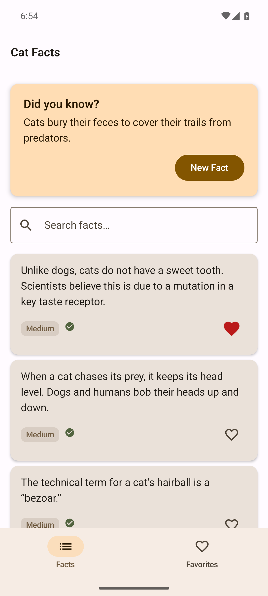
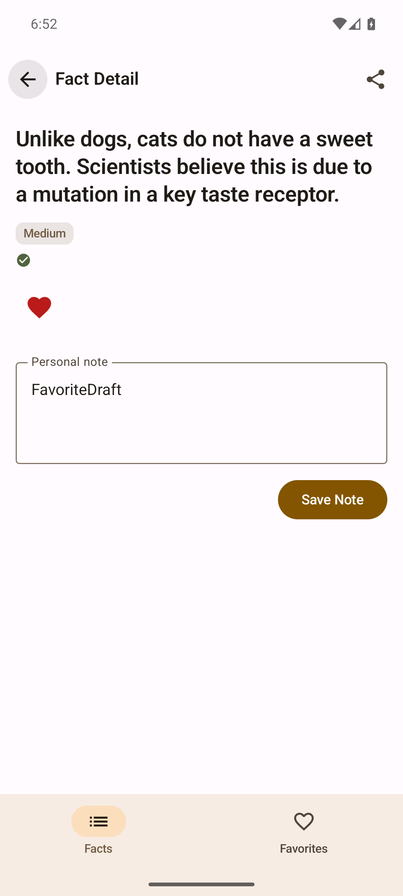
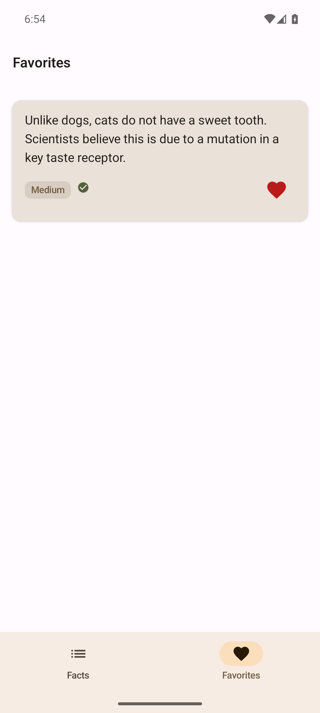
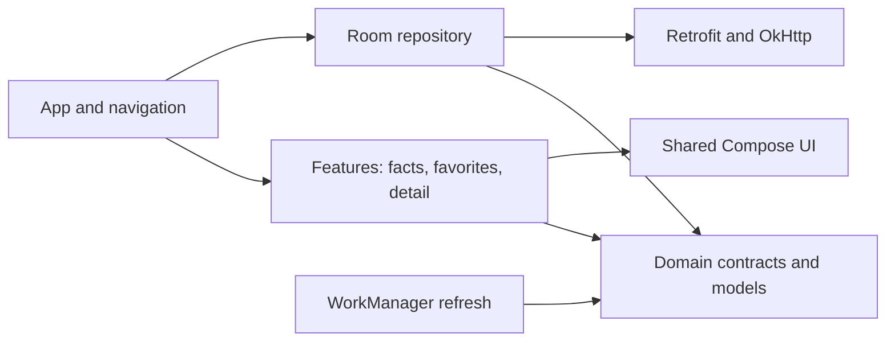

# Katty

A native Android portfolio app for browsing cat facts, saving favorites, and keeping personal notes. Kotlin, Jetpack Compose, ViewModels, Room, and WorkManager are used to make state and persistence behavior explicit and testable.

## Preview

Actual Android API 35 captures: live facts, a draft restored after process death, and a persisted favorite. See [verification evidence](docs/verification.md) for the exercised flows and test scope.

<p>
  
  
  
</p>

## Try it

Use JDK 17 and an Android SDK with platform 37.0. The app supports Android 7.0/API 24 and newer. Create an ignored `local.properties` with your SDK path, or set `ANDROID_HOME`.

```sh
./gradlew :app:assembleDevDebug
./gradlew :app:installDevDebug
```

The public read-only API is [catfact.ninja](https://catfact.ninja/). An internet connection is needed to fetch facts for the first time; cached facts, bookmarks, and notes remain on the device.

## Engineering decisions

- **Room owns displayed data.** Remote refresh updates server-owned columns and explicit feed positions in a transaction. It preserves local bookmarks and notes, including cached facts absent from the latest page.
- **State flows in one direction.** Compose emits events to screen ViewModels and observes immutable `StateFlow` state with lifecycle-aware collection. Navigation entries own their ViewModels and saved state.
- **Responsibilities are separated.** Feature modules own screens and presentation state; core modules own models, persistence, networking, refresh scheduling, and shared UI. Convention plugins centralize Android build settings.
- **Verification is executable.** Unit tests, Room regressions, Compose tests, and navigation tests live beside the code. CI builds the app, runs lint, Detekt and unit tests, checks core coverage, and runs device tests.



The existing feature/core split is retained to demonstrate modular Android work. For a smaller app, fewer modules would reduce build and maintenance cost. TransferFlow documents which patterns it reuses and why.

## Verify it

```sh
# JVM unit tests, including Room tests under Robolectric
./gradlew testDevDebugUnitTest

# Android lint and the focused core coverage gate
./gradlew lintDevDebug detekt verifyCoreCoverage

# Room, Compose, DI and navigation tests on a connected Android device/emulator
./gradlew allInstrumentedTests
```

Reports are generated under each module's `build/reports` and `build/test-results` directories. Generated output is ignored by Git. See [verification evidence](docs/verification.md) for the commands actually run and their scope; a configured check does not imply a passing run.

[Android verification](.github/workflows/android.yml) runs on pull requests and pushes to main. [Dependabot](.github/dependabot.yml) proposes Gradle and action updates weekly. The toolchain is pinned in the version catalog and wrapper; [dependency notes](docs/dependency-policy.md) explain the compatible set and retained versions.

## Persistence semantics

Bookmarks and notes are local-only data. The upstream API provides facts and has no endpoint for those edits. WorkManager refreshes the read cache; it does not upload user annotations. Room v2 separates feed membership from cache freshness. The non-destructive v1→v2 migration retains existing data, including bookmarks and notes. See [ADR 0002](docs/adr/0002-offline-first-caching-strategy.md) and the repository regression tests.

## Performance and scope

A macrobenchmark module and an authored baseline profile are retained. Benchmark builds are profileable and non-debuggable. Run measurements on a physical device and record the device, build, compilation mode, and raw output before making performance claims. Earlier debug-build timings are not current release measurements. See the [benchmark guide](benchmark/README.md).

Older random-fact records may retain historical UUID identities alongside newer content-derived IDs; their annotations are preserved, and duplicate historical text is not destructively reconciled. Cached inactive facts are retained so an open detail can still be edited after refresh.

Telemetry interfaces currently use no-op implementations. The project is a learning and portfolio sample; it has no hosted monitoring service, user account sync, or production service-level claim. The published repository contains Compose/instrumented tests; no Maestro flows are claimed.

## Documentation

- [Persistence decision](docs/adr/0002-offline-first-caching-strategy.md)
- [Modularization](docs/architecture/modularization-strategy.md)
- [Engineering standards](docs/governance/engineering-standards.md)
- [Failure behavior](docs/reliability/failure-mode-analysis.md)
- [Dependency matrix](docs/dependency-policy.md)
- [Verification evidence](docs/verification.md)
